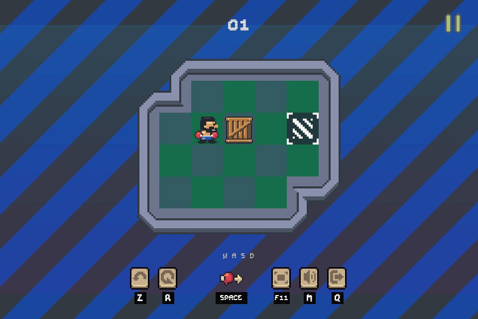
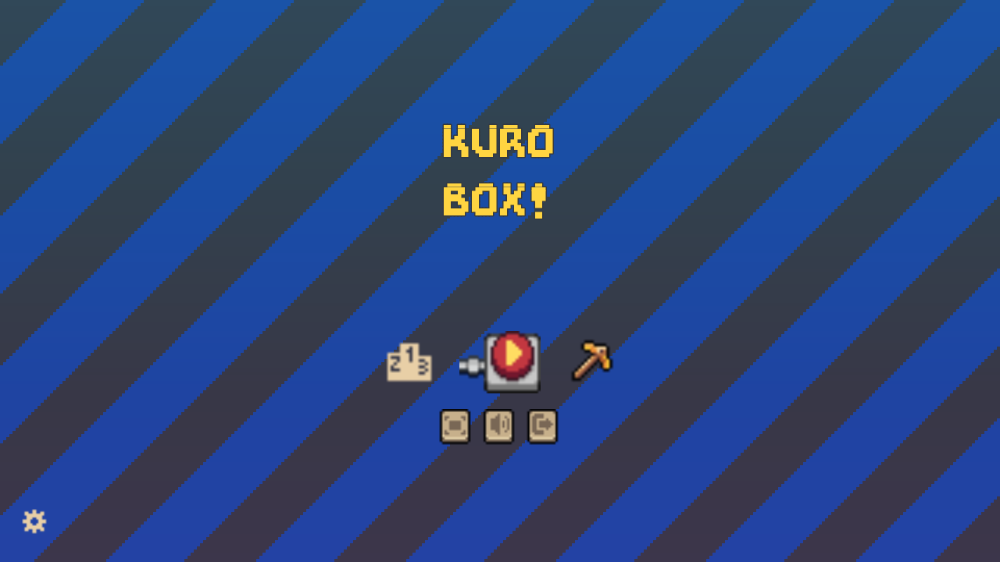
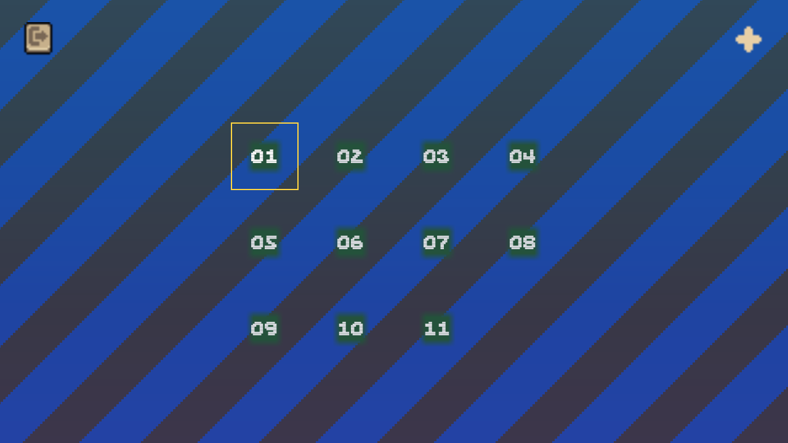
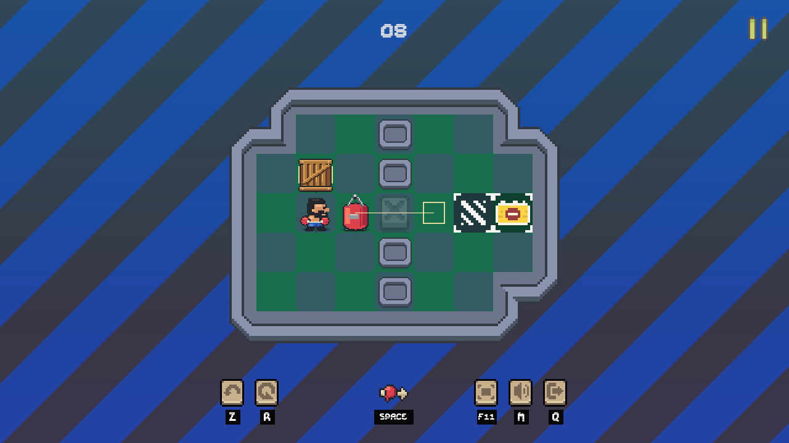
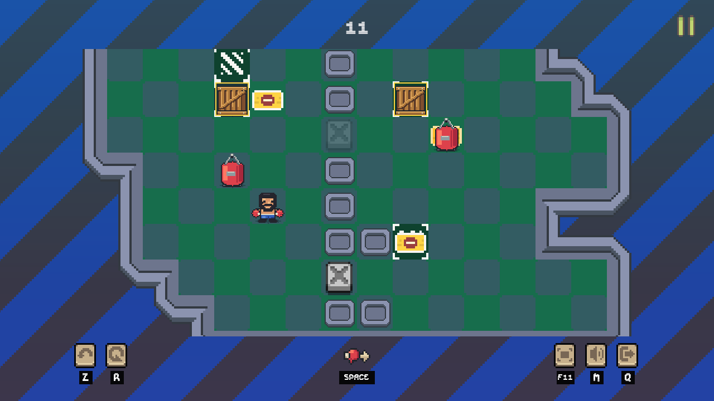
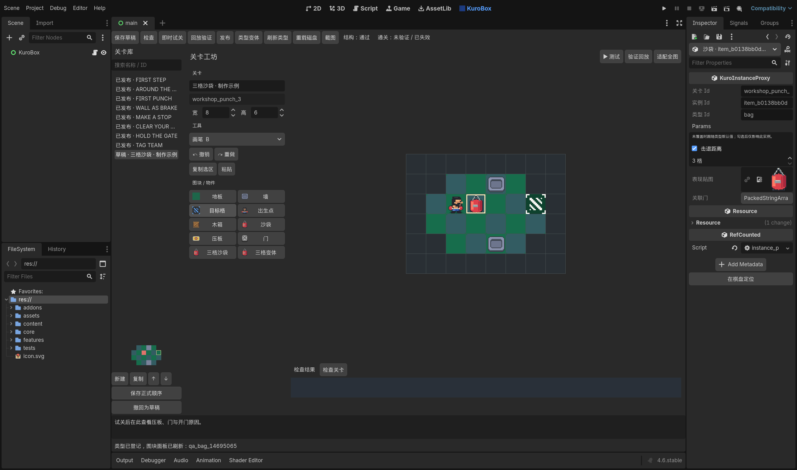
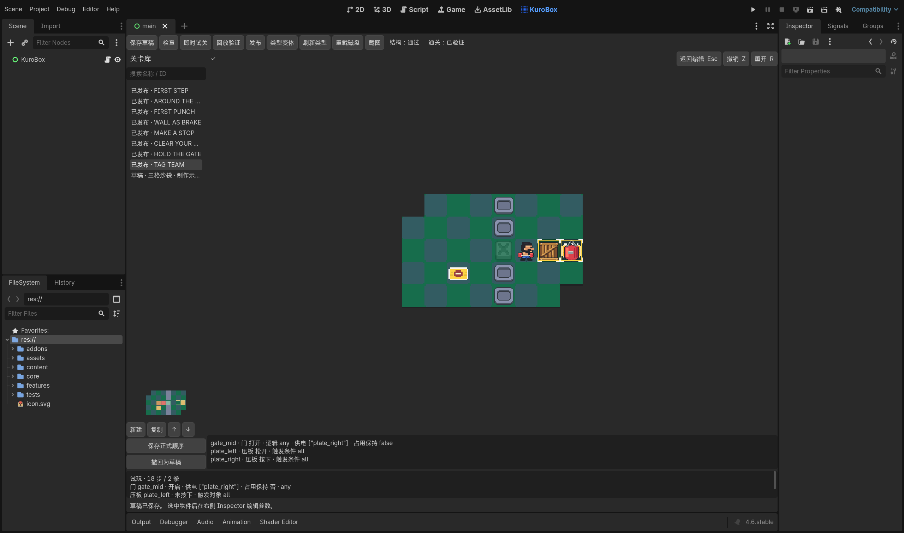

# KuroBox

KuroBox 是一款用 Godot 4.6 和 GDScript 制作的拳击推箱子游戏。有八个基础关、三个进阶关和 Godot 原生关卡编辑器。



推箱、出拳，再到编辑器修改关卡并即时试关。

## 运行游戏

用 Godot 4.6 打开 `project.godot`，按 F5。Windows 导出程序在 `builds/windows/KuroBox.exe`。

<p>
  
  
</p>

- 方向键或 WASD 移动。走向木箱就能推一格。
- Space 朝当前方向出拳。沙袋默认最多前进两格，遇障碍提前停下，角色留在原地。
- Z 撤销，R 重开，Esc 暂停，Q 返回选关或工坊。
- F11 切换全屏，M 同时静音或恢复音乐与音效。

目标格不会截停沙袋。占满所有目标格即可通关。进度和设置存入 `user://profile.json`，写入时保留有效备份。

地格比例固定。地图超出视口时，镜头沿超出的方向平滑跟随角色。边框沿地格轮廓拼接，空格用拳套和右箭头提示。

移动和出拳按输入顺序执行。长按方向键只会排队少量重复指令，松开即取消等待中的重复。暂停、撤销、重开或离开关卡时清空队列。

基础关从推箱、站位和出拳开始。第 5 关用木箱截停沙袋。第 7 关先展示离板关门，再要求持续供电。第 8 关复用布局，让沙袋接替木箱供电，再回收木箱。进阶关扩大回身和暂存空间，用布局引导玩家组合这些机制。



第 11 关中，镜头跟随拳手移到棋盘下方。



关卡变化、输入验证和实际游戏截图见 [关卡与输入更新](docs/campaign_update.md)。

## 在 Godot Editor 制作关卡

点击 Godot 顶部的 **KuroBox**，或从 `Project > Tools > KuroBox 关卡工作台` 进入。找不到入口时，在 `Project Settings > Plugins` 检查 KuroBox Workbench 是否启用。

左侧是关卡库，中间画地图，右侧 Inspector 改所选物件的参数。



1. 新建或复制关卡。ID 用于文件与存档，标题用于显示。复制会把当前编辑内容另存为一关，并重建机关 ID 和内部引用。
2. 分层画地板、墙、目标、实体和装置。拖刷、矩形、填充和选区操作都可整笔撤销。滚轮缩放，中键拖动画布，点“适配全图”恢复视野。
3. 在 Inspector 设置实例覆盖，可改击退距离、压板触发对象或门的压板条件。取消覆盖后恢复类型默认值。选中压板后可用连线按钮指定门。登记的类型变体会出现在图块面板。
4. 草稿可以保存未完成的布局。切关保留未保存的编辑，关闭时提示并留下恢复副本。
5. “即时试关”使用独立 BoardState，返回后保留文档和视角。通关后记录操作，可用“回放验证”重放。修改布局或规则参数后需要重新验证。
6. 结构检查和当前版本的回放均通过后才能发布。可在左侧调整并保存关卡顺序。撤回发布后保留草稿。

试关下方显示压板状态、门的供电来源，以及门是否因被占用而保持开启。点检查结果或 Inspector 的定位按钮可跳到棋盘上的物件。



发现磁盘版本已变更时，可以把编辑内容复制成新关卡，或保留恢复副本后重载。

## 单关场景入口

`features/editor/editor.tscn` 可按 F6 独立运行。游戏菜单的单关工坊也能快速编辑和导入导出 JSON。正式关卡在原生工作台管理。

画笔 B、擦除 E、矩形 R、填充 F、框选 S、移动 M、粘贴 V。Ctrl+Z 撤销，Ctrl+Y 或 Ctrl+Shift+Z 重做。原生工作台用 Ctrl+S 保存草稿。

## 数据和协作入口

- `content/levels/` 存正式关卡，`campaign.json` 定义运行顺序。
- `content/workshop/drafts/` 存草稿，`proofs/` 存对应规则版本的通关记录。发布包只收录正式关卡。
- `content/definitions/objects.json` 存类型默认值，实例通过 `params` 保存覆盖项。
- `core/` 实现校验、离散规则和重放，可脱离 EditorInterface 与动画运行。
- `features/editor/` 提供绘制和试玩，`services/level_workspace.gd` 管理文件与发布。
- `addons/kurobox_editor/` 管理原生主屏、Inspector、编辑历史与文档。
- `assets/source/kurobox_boxing.aseprite` 保存 32 像素素材源文件。类型目录映射画面资源，`audio_service.gd` 定义音频事件。

类型窗口可创建同类变体。新增行为需要实现规则、参数约束、调试状态和测试。参见 [架构](docs/architecture.md)、[工作区](docs/workspace_workflow.md) 和 [工作台说明](docs/native_workbench.md)。

## 检查和导出

```powershell
./tools/validate.ps1 -GodotBin "Godot 4.6 控制台程序路径"
./tools/test_native_editor.ps1 -GodotGui "Godot 4.6 GUI 程序路径"
./tools/test_campaign_playthrough.ps1 -GodotGui "Godot 4.6 GUI 程序路径"
./tools/export_windows.ps1 -GodotBin "Godot 4.6 控制台程序路径" -FetchTemplates
```

原生测试在 `.tools/` 创建隔离工程，用便携配置验证 Inspector、编辑历史、试玩、发布和撤回，并保存截图。请在隔离工程中运行原生 Smoke 参数。Windows 模板缺失时加 `-FetchTemplates`，工具会把官方 Windows 模板下载到工程目录。

游玩测试在隔离工程里派发按键，验证通关、撤销、重开和镜头跟随。截图和布局检查使用 1280×720 与 960×640 两种视口。关卡设计测试搜索能绕过制动、离板关门或供电交接的解法，触及搜索上限时报告失败。

Git 收录源码、关卡和可编辑素材。本地缓存、恢复副本、模板及构建由 Git 忽略。发布程序会重放正式清单，检查打包数据能否读取。

通关回放验证记录里的解法。音频已检查解码、峰值和循环边界，听感与首次游玩仍需试玩验证。
