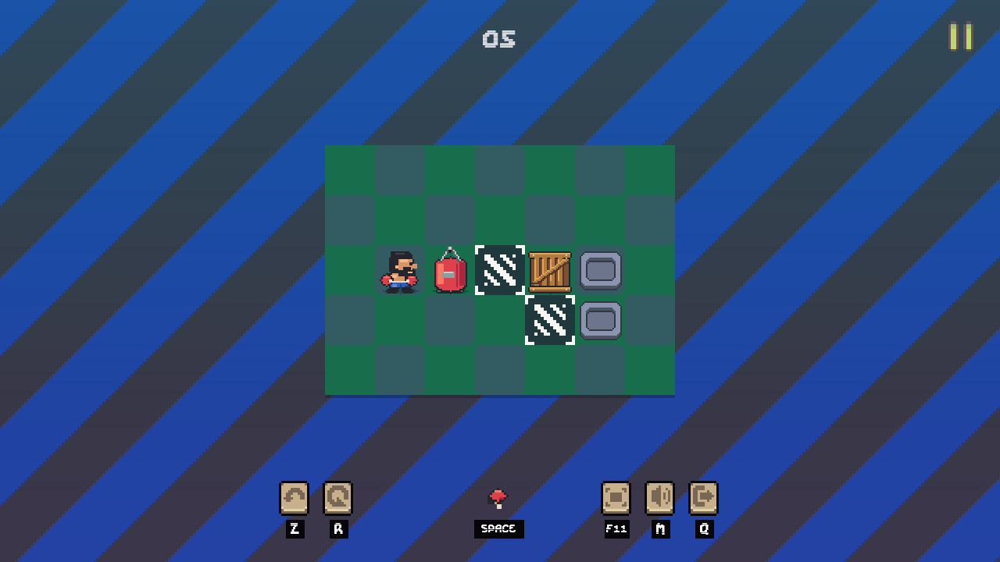
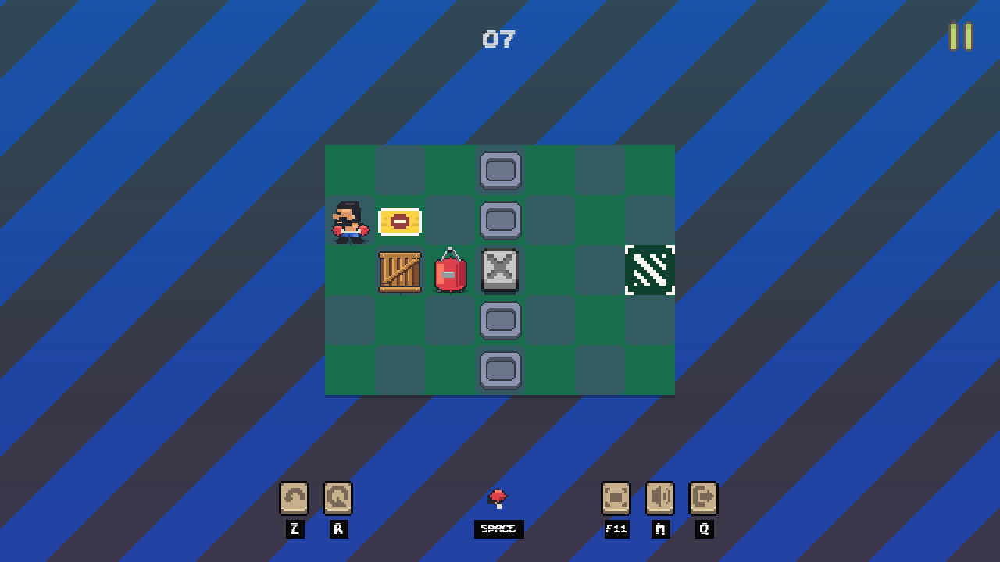
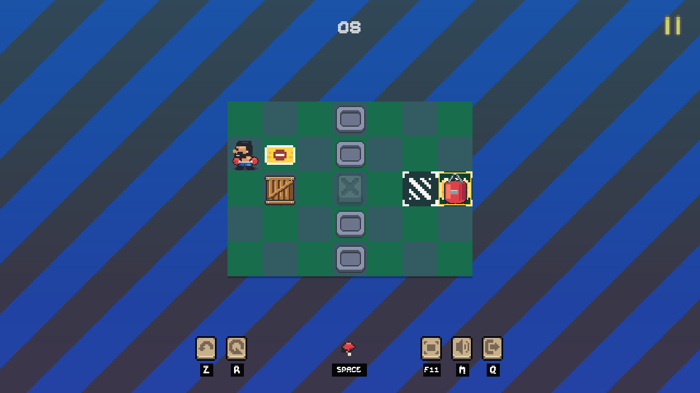
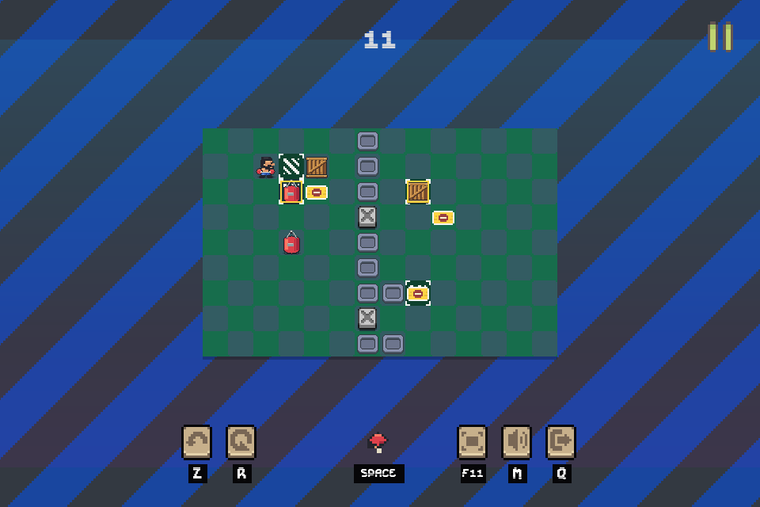

# 关卡与输入更新

正式流程现在是11关。前八关引入基本关系，后三关扩大空间和物件间的依赖。规则、目标判定和拳击距离保持一致，关卡内没有新增文字教学。

第5关清除了旧布局里能借固定墙交换目标的旁路。沙袋必须借移动物件提前停下，再完成交付；仍允许不同解法。第7关从玩家压住压板开始，先观察离板关门，再安排木箱持续供电。第8关沿用同一房间，从已完成供电准备的状态出发，沙袋接班后取回木箱，省去重复铺垫。

## 实际游戏画面

第5关：木箱位于目标后方，下一拳会被它截停。

第7关：玩家离开压板，门关闭；当前位置仍能继续解题。

第8关：左侧压板已经释放，右侧沙袋单独供电，门保持开启。

## 三个进阶关

- 09 BORROWED BRAKE，12×9：木箱先供电，再离开自己的目标担任刹车，最后归位。
- 10 CROSS CIRCUIT，14×10：两只沙袋与木箱轮流制动、供电，必须保持上下两路的通行条件。
- 11 SECOND SHIFT，16×11：回收已完成目标上的物件，打开服务小格，从门侧重新取用刹车木箱。

第11关在960×640视口下的全图与操作栏：

## 快速输入

旧版本在动画中拒绝新指令。实际派发间隔20毫秒的三次独立方向点按，只执行一步；修复后执行三步。移动和出拳按有限FIFO顺序执行，最多等待4条。长按方向最多等待1条重复，抬键删除未执行的重复。暂停、撤销、重开、胜利和离场清空剩余指令，旧动画回调不能推进新场景。

正式11关均通过实际主场景按键重放、通关菜单、撤销和重开验证；1280×720与960×640视口检查全图和操作栏。教学关另做完整可达状态搜索，进阶关检查制动、供电、目标回收和有效记录解。机器结果见 `evidence/validation_summary.json`；这些验证不代替首次玩家对理解与节奏的评价。
