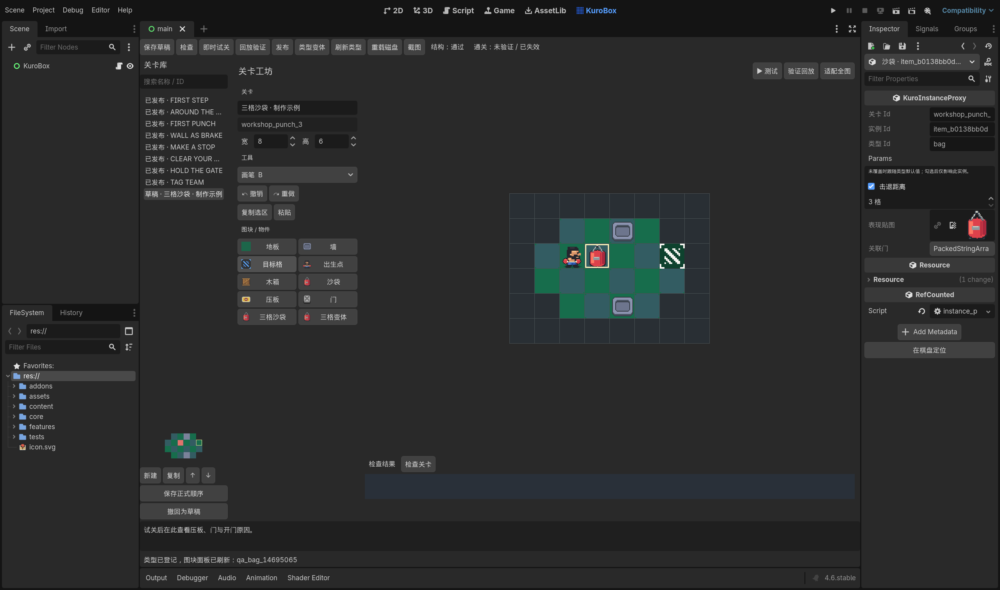
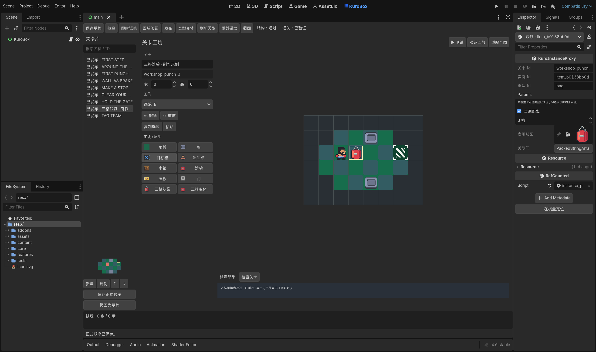
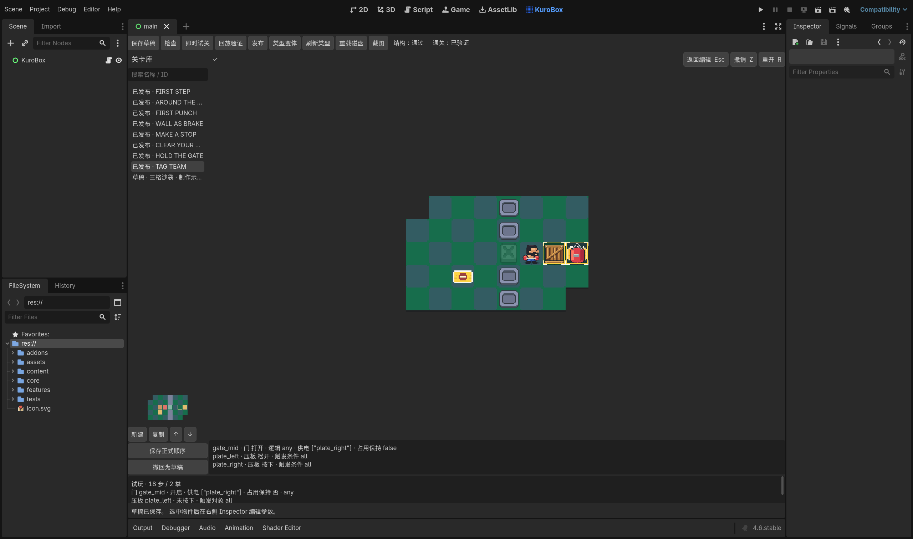

# 原生工作台

Godot 4.6 顶部的 KuroBox 主屏用于正式内容制作。插件入口在 `addons/kurobox_editor/plugin.cfg`，控制器负责连接关卡库、绘制控件、文档资源、Inspector 和发布服务。

## 一次制作任务

复制已有小关，填写新的稳定 ID 和标题。在画布中调整布局；点选沙袋后，在右侧 Inspector 勾选“击退距离”覆盖并改为三格。保存草稿，进入即时试关。通关后返回，点击回放验证，再发布；新关自动登记到正式清单。调整顺序需点击“保存正式顺序”。

工程中保留 `workshop_punch_3` 示例草稿和通关记录，以及 `bag_3` 类型变体。示例使用实例覆盖，正式八关继续使用原类型默认值。这个例子也用于说明：类型默认与实例覆盖各自负责什么。

以下画面来自隔离工程中的真实 Godot 4.6 Editor 验证。发布示例只发生在测试副本，源码中的示例保持草稿。

## 文档、历史与 Inspector

每份作者文档由 `KuroAuthoringDocument` 持有。绘制控件一次提交一笔事务；参数面板提交整份 `params` 字典，工作台校验后形成文档前后快照。两者统一向 Godot 的 EditorUndoRedoManager 登记，使用显式全局资源历史，不混入当前 tscn 的场景修改。

作者资源没有磁盘路径，Godot 可能把它猜成当前场景的资源。这里逐操作固定到作者上下文。快照撤销会恢复“未覆盖”这一状态；修复无效参数后撤销，也保留修复前的原值。Inspector 对无效覆盖显示错误，显示过程不会擅自写入默认值。跨关撤销会切回受影响文档，并清理其他关卡的 Inspector 目标；插件卸载也会清理自己的目标，不清空用户的全局编辑历史。

## 草稿与发布

草稿只要求数据结构能继续编辑，允许目标、出生点或关联尚未完成。试玩和发布使用严格检查；发布还会重新运行通关记录。记录含规则修订、命令及实际计数，显示标题和美术替换不影响规则修订，类型规则与实例覆盖会影响。

保存草稿不覆盖已发布版本。发布按内容、证明、正式清单提交，并在后续步骤失败时恢复已写文件。这里是单文件替换与多文件失败补偿，不保证断电时整组文件同时切换。

每次载入记住文件哈希。外部修改会阻止静默覆盖；列表刷新不会确认新版本。可以从当前内存“复制”为新关，或确认保留恢复副本后重载。撤回发布会先保存当前修改，再将内容保留为草稿。

## 视角和状态排查

滚轮以光标为中心缩放，中键平移，适配按钮回到全图。返回试玩保持作者视角。错误项与 Inspector 的定位按钮会把对应格子移到画布中心。

试关调试信息来自真实 BoardState：压板按下状态与触发对象，门的关联压板、供电来源、任一/全部条件，以及占门保持。回放走同一命令接口，不能只播放演出。

## 恢复和验证

未保存文档及待保存顺序写入 `.godot/kurobox_editor/` 恢复文件，使用临时文件替换和有效备份；重载前另存恢复副本。它不替代正式保存草稿，删除引擎缓存也会清除这些临时恢复点。

恢复会话允许墙与箱子重叠等尚未修好的中间状态，保留失效类型或参数的原文，并提示检查。无法安全载入的结构另存隔离文件，界面显示路径与原因；隔离写入失败时停止覆盖原恢复文件。

`tools/test_native_editor.ps1` 复制隔离工程，用便携编辑器配置运行真实 Editor、Inspector 和编辑历史，验证参数覆盖的撤销重做、跨关同步、试关、发布、顺序与撤回，并保存真实视口截图。制作工程不会被该验证发布测试关卡；默认正式流程仍是八关。输入流程测试的固定夹具和正式关卡解法验证分开记录。
